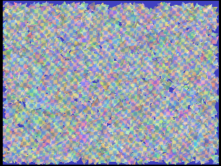

# N64 RDP spike: paraLLEl-RDP on MoltenVK + cxd4 RSP, no JIT (13 Nov 2026)

**Question:** can real N64 graphics (the RDP) run at full speed on an iPhone without JIT, using paraLLEl-RDP
(Vulkan compute) on MoltenVK, with an interpreter-only LLE RSP for graphics tasks? The answer decides whether N64
ships in v2 or v3.

**Short answer:** yes on the Mac with lots of headroom, and very probably yes on recent iPhones. On an M4 Mac mini
our worst-case bench ROM runs at **107 fps** (synchronous RDP; 131 fps asynchronous) and a busy-game load at
**153 fps**, against 60 needed. Scaled to iPhones (estimate, not measured) that is roughly 75-105 fps for a busy
load on A15-A18 Pro, and 50-75 fps for the stress load. **Recommendation: v2, provisionally**, once Gordon's
on-device run (below) confirms the estimate. The bottleneck is the CPU side (R4300 interpreter + RSP interpreter),
not the GPU.

The first spike commit kept everything out of the shipping app; build 4 (update below) wires the bench in.

> **Update (build 4, 13 Nov 2026):** Gordon can't cable his iPhone (18 Pro Max), so the bench now ships inside
> the main app instead of the separate N64Bench app: **About › long-press the version line (1 s) › N64 speed
> test › Start**, then **Share report**. paraLLEl-RDP and cxd4 are vendored unmodified in
> `Packages/CoreKit/Sources/MUPEN64/parallel-rdp` and `rsp-cxd4` and built through `glue/rdp`; MoltenVK's
> device library is in `ThirdParty/moltenvk` and linked for device builds only; the ROM is an N64Core resource
> (built by `Tools/build_n64_bench_rom.py`, allowed by name + SHA-256 in the Release ROM check). cxd4's SIGSEGV
> probe, SIGILL handler and `srand` are neutralised in `glue/rdp/cxd4_unit.c`. N64 games stay Debug-only;
> the N64Bench project and §8's cable steps are superseded. The Mac CLI remains (`Spikes/N64RDP/build_mac.sh`).

## 1. Licences (checked from the downloaded files)

| Component | Version | Licence found | GPLv3-compatible |
|---|---|---|---|
| paraLLEl-RDP (`parallel-rdp-standalone`) | `388d70f` (upstream parallel-rdp `1cecd04`), 9 Nov 2024 | MIT (`LICENSE`, "Copyright (c) 2020 Themaister"; same header in every `.cpp/.hpp`; `luts.hpp`, `fb_formats.h` and the generated SPIR-V header `slangmosh.hpp` have no header and fall under the repo's MIT `LICENSE`) | yes |
| Granite Vulkan backend (bundled in it: `vulkan/`, `util/`) | same | MIT (same headers) | yes |
| volk (bundled) | header version 269 | MIT (notice at the end of `volk.h`) | yes |
| Vulkan-Headers (bundled) | 2024 | Apache-2.0 (`SPDX-License-Identifier: Apache-2.0` in all 29 headers) | yes (GPLv3 only, not GPLv2) |
| cxd4 RSP (`mupen64plus-rsp-cxd4`) | `b8e747b`, 10 Nov 2026 | CC0 1.0 (`COPYING`; "License: CC0 Public Domain Dedication" in every interpreter file) | yes |
| ↳ `osal_dynamiclib_*.c/.h` in that repo | | GPL-2.0-or-later | yes, but **not used** (our glue provides `osal_dynlib_getproc`) |
| ↳ `sse2neon/SSE2NEON.h` | | MIT | yes, not used (it doesn't compile on arm64) |
| MoltenVK | v1.4.2 release, prebuilt | Apache-2.0 (`LICENSE`) | yes (GPLv3 only) |

Nothing is GPL-2.0-only. **One thing to note (not a blocker):** Apache-2.0 (MoltenVK, Vulkan-Headers) is compatible
with GPLv3 but not with GPLv2, so with this renderer the N64 part can only be distributed under GPLv3. mupen64plus is
"GPL-2.0-or-later", so that is fine, and the app is going GPLv3 anyway. MoltenVK also contains SPIRV-Cross
(Apache-2.0) and other permissive parts; a shipping build needs their notices in `Licenses/` and About, plus the
usual Fable licence review of each new component.

Downloads (approved by Gordon, ~56 MB): `parallel-rdp-standalone` and `mupen64plus-rsp-cxd4` shallow clones
(10 MB + 0.6 MB) and `MoltenVK-ios.tar` (34.5 MB, extracted to the static xcframework only) in `ThirdParty-src/`
(gitignored), plus only `libMoltenVK.dylib` (10.9 MB) out of `MoltenVK-macos.tar` (fetched by HTTP range requests
so the other 49 MB of that tar were never downloaded). No ROMs, BIOS or microcode were downloaded.

## 2. What was built

- `Spikes/N64RDP/src/rdp_spike.cpp`: paraLLEl-RDP behind our glue. Vulkan through MoltenVK (dlopen on the Mac;
  on iOS the static library's `vk_icdGetInstanceProcAddr`); RDRAM imported directly with
  `VK_EXT_external_memory_host` (16 KB alignment, worked); `ProcessRDPList` reads DPC_CURRENT..DPC_END from RDRAM or,
  with the XBUS bit, from DMEM, carries commands that straddle two calls, and at SyncFull waits for the GPU
  (synchronous mode) and raises the DP interrupt; the VI runs on the GPU (`scanout_sync`) and is read back into the
  glue's 320x240 framebuffer. Timing counters for every stage, GPU time from Vulkan timestamps.
- `Spikes/N64RDP/src/rsp_dispatch.c` + `cxd4_unit.c`: RSP dispatcher. OSTask type 1 (graphics) goes to cxd4's
  interpreter, everything else (audio etc.) stays on rsp-hle. cxd4 is compiled unmodified through its own unity file
  with renamed entry points; its RDRAM-size probe (reads until it takes a SIGSEGV, which a debugger stops on) is
  disabled by the build unit and the size set afterwards.
- `Spikes/N64RDP/src/volk_rename.h`: renames volk's `vk*` function-pointer globals, which otherwise collide with
  the statically linked MoltenVK's real `vk*` functions on iOS.
- Glue hooks in `n64_glue.c` (all `#ifdef N64_RDP_SPIKE`): ProcessRDPList, RomOpen/RomClosed, scan-out, the RSP
  table and cxd4 startup/shutdown.
- `Spikes/N64RDP/rom/build_rdpbench_rom.py` → `n64_rdpbench.z64` (1 MB, ours; see §3).
- `Spikes/N64RDP/bench/`: the bench runner (`bench_core.c`) and the Mac CLI (`bench_mac.c`, built by
  `Spikes/N64RDP/build_mac.sh` with clang directly, ~5 s).
- `Spikes/N64RDP/ios/`: XcodeGen spec for **N64Bench**, a separate device-only app (bundle id
  `com.iqlabs.duoemulator.n64bench`) that runs the same bench and shows fps, the breakdown and the live frame. It is
  a separate app rather than a screen in the shipping app because it needs its own copy of mupen64plus compiled with
  `N64_RDP_SPIKE` (two copies can't link into one binary), and so nothing reaches `DuoEmulator.xcodeproj`. Builds
  for `generic/platform=iOS` (verified, Release, signing off). Its scheme runs the Release configuration.

## 3. The bench ROM (ours, no commercial game)

Per frame: the **CPU** waits for VBlank, flips the double-buffered 320x240 16-bit framebuffer, writes an OSTask
(type 1) to DMEM, starts the RSP and waits for it, then runs a game-like loop (loads/stores, integer and FPU maths)
for most of the rest of the frame. The **RSP** runs our own microcode: it DMAs a constants block in, runs a
166-instruction vertex-transform + triangle-setup kernel once per triangle (vector multiply-accumulate chains,
reciprocals, compare/merge, clip compares, 22 stores of the triangle command; modelled on what a real graphics
microcode spends per triangle), then streams the frame's RDP command list from RDRAM through two 1 KB DMEM buffers
to the RDP over the XBUS, and ends with SyncFull. The **RDP** clears Z and colour in fill mode, then draws the
triangles: shaded, textured (32x32 RGBA16, bilinear, perspective path on), Z-buffered, anti-aliased, with
framebuffer read (the usual opaque-surface render mode).

| Level | Triangles | Covered area | RSP kernel load (real RSP at 62.5 MHz) |
|---|---|---|---|
| 1 | 800 | 1.0x screen | ~0.13 M instr/frame (~13 %) |
| 2 | 2,000 | 2.0x screen | ~0.33 M (~32 %): a busy N64 scene |
| 3 | 4,000 | 3.0x screen | ~0.66 M (~64 %): beyond the console's worst case at 60 fps |

Each level runs 240 frames; the bench skips the first 40 of each (pipeline warm-up) and runs unthrottled.



## 4. Mac numbers (Mac mini M4: 4 P-cores, 10-core GPU, 16 GB; MoltenVK 1.4.2)

Device line: `Apple M4 | Vulkan 1.3 | host-memory import yes (align 16384) | subgroup 32 | int8/16 yes`.
Milliseconds per emulated frame (full speed = 16.67 ms). Two runs agree within 1 %.

**Synchronous RDP** (CPU waits for the GPU at every SyncFull: safe for games that read back what the RDP drew):

| Level | Frame | fps | CPU (R4300 interp.) | RSP (cxd4) | RDP queueing | GPU wait | VI + readback | GPU RDP time | Worst frame |
|---|---|---|---|---|---|---|---|---|---|
| 1 | 4.66 | 215 | 2.25 | 0.68 | 0.25 | 0.58 | 0.89 | 0.34 | 26 (first frame: pipeline builds) |
| 2 | 6.55 | **153** | 2.24 | 1.69 | 0.60 | 1.11 | 0.90 | 0.80 | 6.8 |
| 3 | 9.38 | **107** | 2.24 | 3.39 | 1.28 | 1.57 | 0.90 | 1.72 | 11.8 |

**Asynchronous RDP** (only the VI waits): level 1 245 fps, level 2 **191**, level 3 **131**.

Reading the numbers:
- cxd4 costs ~5.1 ns per RSP instruction on the M4 (~195 M RSP instructions/s): a fully busy real RSP (62.5 M
  instructions/s) would take about a third of one M4 core. It scales linearly with the microcode's work.
- The R4300 cached interpreter is a flat ~2.25 ms per frame for our game-like loop (the core executes a fixed
  budget of instructions per frame whatever the game does).
- The GPU is not the limit: 1.7 ms for 4,000 textured Z-buffered triangles at 3x fill. paraLLEl-RDP's queueing
  (~0.3 µs per triangle on the CPU) is.
- Whole bench process: 86 MB peak resident memory.
- Route check: the Mac run with `N64RDP_USE_ICD=1` initialises Vulkan exactly as the iOS build does (MoltenVK's
  ICD entry point, renamed volk globals): same results.

## 5. iPhone estimate (not measured: needs Gordon's run)

Method: scale the CPU-side columns (CPU + RSP + RDP queueing + VI) by single-core speed relative to the M4, the GPU
wait by GPU speed, then add 20 % for sustained thermal throttling on a phone. Relative speeds are approximate
public-benchmark ratios (Geekbench 6 single-core and Metal), so treat the result as ±25 %.

| iPhone (chip) | CPU vs M4 | GPU vs M4 | Level 2 (busy), sync | Level 3 (stress), sync |
|---|---|---|---|---|
| 16 Pro (A18 Pro) | 1.12x slower | 1.7x | ~9.6 ms, **~105 fps** | ~13.7 ms, **~73 fps** |
| 15 Pro (A17 Pro) | 1.3x | 2.0x | ~11.2 ms, **~90 fps** | ~15.9 ms, **~63 fps** |
| 14 Pro / 15 (A16) | 1.45x | 2.4x | ~12.7 ms, **~79 fps** | ~18.1 ms, ~55 fps |
| 13 / 14 (A15) | 1.65x | 2.6x | ~14.2 ms, **~70 fps** | ~20.4 ms, ~49 fps |

Asynchronous mode gains another ~15-20 %. Why it is probably fine: Apple's A-series P-cores are the same designs as
the M-series ones at slightly lower clocks, and the work is single-threaded (one emulation thread, plus paraLLEl's
light worker threads), so the two P-cores of an iPhone are enough; the GPU has 3-8x headroom.

What could make real games slower than this bench (all unknowable without commercial ROMs, which we never use):
- Games the ROM database runs at CountPerOp 1 double the R4300 work (+2.25 ms on the M4, ~+3.3 ms on an A16).
- Real microcode (F3DEX2 and friends) may spend more or less per triangle than our 166-instruction kernel; audio
  via rsp-hle adds ~0.3-1 ms.
- Framebuffer effects with several SyncFulls per frame, 640x480 games (4x the fill), 2-cycle modes and many TMEM
  loads all add GPU and sync time; the GPU has room for that.
- The bench reads every frame back to the CPU (0.9 ms); a shipping build would hand paraLLEl's VkImage to Metal
  instead (MoltenVK can export the MTLTexture), which saves most of that.

## 6. Risks

- **MoltenVK on iOS:** proven here only on macOS (same code path via the ICD entry point). The iOS build links and
  should start; it has not run on a device yet. MoltenVK ships in App Store apps, so App Review isn't the issue. The
  iOS release has **no simulator slice**, so N64Bench is device-only: it can't even be started in the simulator
  (and simulator GPU numbers would be meaningless anyway).
- **Compute features:** paraLLEl-RDP needs Vulkan 1.1 + 8/16-bit storage; it uses int8/int16 arithmetic and
  subgroups when present (the M4 has all three). Apple GPUs from the A14 on report the same Metal features, so
  expected fine; older chips may fall back to slower paths. `VK_EXT_external_memory_host` worked (otherwise a
  slower copy path).
- **Shader compile stutter:** the first frame with a new RDP state took 22-26 ms on the M4 (SPIR-V → MSL → Metal
  compile). Real games hit hundreds of state combinations, so expect hitches until warm. paraLLEl compiles
  specialised pipelines asynchronously with an ubershader fallback, which helps; persisting Metal pipeline caches
  needs a look.
- **Binary size:** the N64Bench binary is 7.9 MB; the Mac CLI without MoltenVK is 3.1 MB, so MoltenVK adds ~4.7 MB
  and paraLLEl-RDP + cxd4 ~1.5-2 MB on top of mupen64plus.
- **Memory:** 86 MB peak for the whole Mac bench; on the GPU side RDRAM is imported, not copied (hidden RDRAM
  4 MB, TMEM, tile buffers). Fine for any recent iPhone.
- **cxd4 integration quirks** (a shipping build needs patches in `ThirdParty/mupen64/patches/`-style form or our
  own units): the SIGSEGV RDRAM probe (disabled here), a permanent SIGILL handler it installs, process-wide
  globals, and its `message()` path.
- **Thermals and battery:** a phone sustaining ~60-80 % of a P-core plus GPU will warm up; the 20 % allowance above
  is a guess until a 10-minute device run.
- **Unproven game compatibility:** paraLLEl-RDP is very accurate (bit-exact against Angrylion), but our microcode
  is not Nintendo's; how commercial games behave can only be learned from Gordon's own cartridges.

## 7. Recommendation

**v2, provisionally.** The architecture works end to end without JIT (R4300 cached interpreter → cxd4 LLE RSP →
paraLLEl-RDP compute on MoltenVK → VI on the GPU), and the Mac shows 2.5x headroom at a busy-game load and 1.8x at a
stress load. Scaled down, iPhones from the A15 on should hold 60 fps on busy scenes, and A17 Pro and newer even on
the stress load. Confirm with the device run below: **if level 2 (synchronous) shows about 75 fps or more on
Gordon's iPhone, plan N64 for v2** (with a "recommended: iPhone 13 or newer" note); if it is under ~60 fps, push to
v3 and look at RSP speed-ups first (cxd4 vector unit tuning for NEON, or HLE graphics only for well-known
microcodes).

Work still needed for a shipping N64 renderer: zero-copy VI output to Metal, cxd4 quirk patches, pipeline cache,
a Fable licence review of paraLLEl-RDP/Granite/volk/Vulkan-Headers/MoltenVK/cxd4, licence texts in `Licenses/`
and About, and per-game testing on Gordon's own cartridge dumps.

## 8. Gordon's on-device test (plain iPhone, ~5 minutes)

1. On this Mac, in Terminal:
   `cd ~/duo-emulator/Spikes/N64RDP/ios && xcodegen generate && open N64Bench.xcodeproj`
   (needs `~/duo-emulator/ThirdParty-src/`, which is already there).
2. Plug the iPhone in with a cable, unlock it and tap **Trust** if asked. If Xcode says Developer Mode is off:
   iPhone **Settings › Privacy & Security › Developer Mode** → on, then restart the phone.
3. In Xcode's toolbar pick the scheme **N64Bench** and your iPhone as the destination. Signing uses your team from
   `Local.xcconfig`; if Xcode shows a signing prompt, let it register the device / create the profile.
4. Press **Run** (⌘R). The app starts the bench by itself: about a minute synchronous, then about a minute
   asynchronous. Keep the phone unlocked and the app in front. The coloured triangle frame and a status line update
   as it goes.
5. When it says **Done**, tap **Share report** (AirDrop or Notes) or copy the same text from Xcode's console, and
   send it back. The numbers that matter are the `fps` column for levels 2 and 3, and the thermal state line.
6. Delete the N64 Bench app from the phone afterwards. Nothing is uploaded anywhere; don't TestFlight it.

## How to rebuild

```
cd ThirdParty-src
git clone --depth 1 https://github.com/Themaister/parallel-rdp-standalone.git    # 388d70f
git clone --depth 1 https://github.com/mupen64plus/mupen64plus-rsp-cxd4.git      # b8e747b
# MoltenVK v1.4.2: MoltenVK-ios.tar → moltenvk/MoltenVK/{LICENSE,MoltenVK/static,MoltenVK/include/MoltenVK};
#                  MoltenVK-macos.tar's MoltenVK/MoltenVK/dynamic/dylib/macOS/libMoltenVK.dylib → moltenvk/macos/
cd ..
python3 Tools/build_n64_bench_rom.py      # then update its SHA-256 in project.yml's Release ROM check
Spikes/N64RDP/build_mac.sh                # needs only ThirdParty-src/moltenvk/macos/libMoltenVK.dylib now
N64RDP_ROOT=$PWD build/n64rdp-spike/mac/n64rdp_bench Packages/CoreKit/Sources/N64Core/Resources/n64_rdpbench.z64 [--async] [--ppm frame.ppm]
```

## 9. Device result (Gordon, 13 Nov 2026, build 4 via TestFlight)
iPhone 18 Pro Max (iPhone19,7, A20 Pro), iOS 27.2.1, thermal nominal throughout. MoltenVK + paraLLEl-RDP ran first time on device.

| Load | Sync fps | Async fps |
|---|---|---|
| Light (800 tris) | 298 | 342 |
| Busy (2,000) | 214 | 242 |
| Stress (4,000) | 142 | 164 |

Faster than the M4 Mac. Worst frame was 24.8 ms on first use (shader build), otherwise under 8 ms.
**Decision: N64 goes in v2** (threshold was 75 fps busy). Still unknown: older iPhones (A15/A16), real
games' heavier microcode and CountPerOp, shader-compile stutter (consider a pipeline cache).
